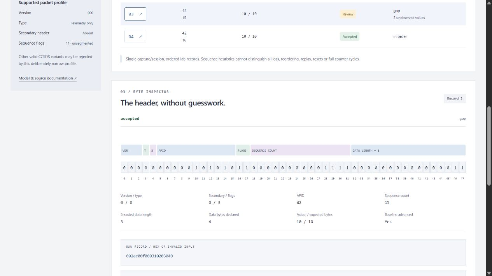

# CCSDS Telemetry Integrity Lab

**Read the bytes. Know the limits.** An offline Rust/Python telemetry inspection workbench by [Jason Stys](https://github.com/JasonStys).

[](https://github.com/JasonStys/ccsds-telemetry-integrity-lab/actions/workflows/validate.yml)
[](https://github.com/JasonStys/ccsds-telemetry-integrity-lab/actions/workflows/codeql.yml)



Decode a restricted CCSDS telemetry packet profile, inspect every primary-header bit, compare the **actual native Rust parser** against an independent Python implementation, and review sequence behavior without conflating gaps, reordering, resets, repeats and payload authenticity.

This is original educational software, **not a complete CCSDS protocol entity, certified decoder, flight-qualified component or operational ground system**. All built-in examples are invented. There is no live spacecraft/radio connection, command transmission, routing, targeting or hardware interface. Structurally accepted packets can still contain changed or unauthenticated data: this profile verifies no embedded payload checksum or sender identity. A report SHA identifies its contents; it is not an authenticated signature.

## Demonstrated engineering

- Dependency-free Rust 1.98.1, forbidden unsafe code, bounded parsing and a borrowed accepted payload rather than a packed-struct cast.
- Checked network-byte-order primary header, exact length, payload cap and explicit unsupported-profile outcomes.
- Independent Python quotient/remainder reference, compared against every native result. Disagreement withholds evidence; Python never substitutes for a missing/broken native worker.
- Per-APID modulo continuity review with deliberate non-advancement on duplicate/reused/late/ambiguous records; idle packets do not contaminate application baselines.
- Twelve synthetic cases, 108 finite configurations, exhaustive native field/length tests, 50,000 seeded hostile-byte records and cross-language property tests.
- Accessible responsive TypeScript UI, proportional 48-bit header graphic, record filters, exact raw/declared sizes, opaque payload view and failure/retry behavior.
- JSON/CSV/inert HTML/input-capture exports, deterministic full evidence hashes and opt-in immutable local SQLite history.
- Cross-platform CI, locked dependencies, native packaged-app smoke tests and no Actions artifact/cache uploads.

## Run the app

Download the matching ZIP and `.sha256` from [Releases](https://github.com/JasonStys/ccsds-telemetry-integrity-lab/releases). Verify the digest, extract the **whole directory**, and launch `TelemetryIntegrityLab` (`.exe` on Windows). It starts a loopback service and opens your default browser. Stop its console with Ctrl-C. No global Rust/Python/Node installation, account, cloud API or administrator privileges are required for the portable app.

Bundles are **unsigned/not notarized**. Do not bypass OS warnings, disable protection, remove quarantine or run elevated. Use reviewed source if policy blocks unsigned binaries. Native releases target Windows x64, Linux x64 and macOS ARM64—not every OS release or mobile device. The website is a local browser application, not a publicly hosted multi-user service.

### From source

Install Rust/rustup, CPython 3.12–3.14 and Node 24. The tracked Rust toolchain selects the reviewed compiler; packaging also needs its `rust-docs` component for redistribution notices.

```text
python -m venv .venv
# Windows: .venv\Scripts\activate
# Linux/macOS: source .venv/bin/activate
python -m pip install --require-hashes -r requirements-dev.lock
cargo build --release --locked
npm ci
npm run build
python -m packetlab serve
```

The printed URL is `http://127.0.0.1:<ephemeral-port>/`. `serve --no-browser --port 8825` selects a fixed port. The server never listens on a public interface. Rust is necessary to build from source; the Python reference is not a runtime fallback.

Try **Missing sequence values**, inspect record 3, then compare **Delayed record after a gap**, **Half-range ambiguity**, and **Undetectable payload bit flip**. The last one intentionally passes structural checks: the UI must not claim a check it never performed.

## Capture and CLI

One ASCII hex packet per newline in a **lab capture format**. These trusted record boundaries are not a CCSDS framing or resynchronization mechanism. Example: `002ac0010002deadbe` decodes to APID 42, sequence 1, unsegmented data and three opaque payload bytes. [examples/nominal.hex](examples/nominal.hex) is editable.

```text
python -m packetlab export --scenario sequence-gap --output evidence.json
python -m packetlab export --scenario nominal --format input --output capture.hex
python -m packetlab export --input capture.hex --payload_limit 128 --forward_window 256 --output local-review.json --history local.sqlite3
```

Imports are CLI-only, capped at 128 KiB and 128 records; each decoded record is at most 4102 bytes. Unsupported or malformed records remain in the report, while an invalid capture envelope is rejected completely. Exports never overwrite. History is opt-in, plain local data and capped at 100 distinct reports; it is never exposed over HTTP. Use synthetic, non-sensitive captures. See [API](docs/API.md) and [user guide](docs/USER_GUIDE.md).

## Verify

```text
cargo fmt --check
cargo clippy --locked --all-targets -- -D warnings
cargo test --locked
python -m ruff check packetlab tests tools launcher.py
python -m ruff format --check packetlab tests tools launcher.py
python -m mypy packetlab
python -m pytest --cov=packetlab --cov-report=term-missing
python tools/benchmark.py
python tools/verify_repo.py
npm run format:check
npm test
npm run build
npx playwright install chromium firefox webkit
npm run test:e2e
```

Linux browser setup may need `--with-deps`. CI exercises the production handler/native worker/build in four OS/Python configurations, three browser engines and three frozen-app builds. CodeQL covers Python and TypeScript; Rust uses its compiler, forbidden-unsafe lint, strict Clippy and native tests, **not an unsupported claim of Rust CodeQL scanning**. See [validation evidence](docs/VALIDATION.md).

## Repository map

| File/area                                                               | Responsibility                                                                                  |
| ----------------------------------------------------------------------- | ----------------------------------------------------------------------------------------------- |
| `rust/lib.rs`                                                           | Zero-copy byte inspection, bounded hex decode, fixed-key JSON and native exhaustive/fuzz tests  |
| `rust/main.rs`                                                          | Bounded stdin-only native worker; validates complete capture envelope before any output         |
| `Cargo.toml`, `Cargo.lock`, `rust-toolchain.toml`, `.cargo/config.toml` | Zero-crate compiler/build/lint contract; static Windows CRT linkage                             |
| `packetlab/reference.py`                                                | Independent arithmetic reference and capture-envelope limits                                    |
| `packetlab/native.py`                                                   | Fixed local/bundled worker bridge, timeout and response-contract checks                         |
| `packetlab/engine.py`                                                   | Invented captures, finite settings, continuity state, cross-language gate and canonical reports |
| `packetlab/reports.py`, `resources/history.sql`                         | Inert exports, verified hashes and immutable parameterized local history                        |
| `packetlab/server.py`, `__main__.py`, `launcher.py`                     | Read-only protected loopback service and source/portable CLI                                    |
| `web/`                                                                  | Semantic interface, escaping/finite controls, bit graphic, responsive styles and unit tests     |
| `tests/`                                                                | Actual native/reference properties, sequence/state cases, HTTP/CLI/SQL and browser acceptance   |
| `tools/`                                                                | Benchmark contracts, exact-line/file inventory, native packaging/smoke and gated draft releases |
| `examples/`, `docs/`, `licenses/`                                       | Synthetic input, model/architecture/API/usage/security/evidence and redistribution notices      |
| `.github/workflows/`                                                    | Validation, CodeQL and manual three-platform release                                            |

Every individual file is summarized in [FILE_CATALOG](docs/FILE_CATALOG.md). [CODE_INDEX](docs/CODE_INDEX.md) provides generated exact definition/argument/variable/field locations; descriptive source headers and contracts reference this instead of duplicating fragile line numbers. CI rejects stale inventories or missing Python definition contracts/creator headers.

## Author, sources and contact

Designed and engineered by [Jason Stys](https://github.com/JasonStys). [Portfolio](https://jasonstys.github.io/portfolio-case-study-site/), [questions/issues](https://github.com/JasonStys/ccsds-telemetry-integrity-lab/issues). MIT original source. Normative field baseline: official [CCSDS 133.0-B-2](https://ccsds.org/Pubs/133x0b2e2.pdf), June 2020, distributed EC2 PDF; the implementation claim remains deliberately restricted. See [model](docs/MODEL.md), [security](SECURITY.md) and [third-party notices](docs/THIRD_PARTY.md). No government, military, NASA or contractor affiliation/endorsement is implied.
